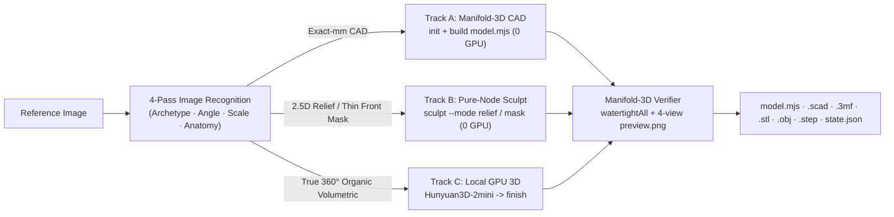

# Image to 3D Agent

[](https://github.com/TangPhuHour/image-to-3d-agent/actions/workflows/ci.yml)
[](LICENSE)
[](https://nodejs.org)
[](#three-100-local-tracks)

Turn reference images into **watertight, 3D-printable models and editable parametric code** — **100% locally offline inside Claude Code, Antigravity (AGY), Cursor, or Codex**, with **zero signups, zero cloud 3D API keys, and zero external 3D apps**.

- **Zero signup & `$0` forever:** No Hugging Face token, no cloud API billing, no rate limits, no browser hopping.
- **Tiny zero-install core (`1.8 MB` repo / `372 KB` portable skill):** Runs on **Node.js 18+** alone (`0` `npm install`, `0` Blender, `0` OpenSCAD) using bundled **Manifold-3D WASM**.
- **Optional Local GPU Track (`setup-gpu`):** One-command isolated setup unlocks **100% offline `Hunyuan3D-2mini`** on Apple Silicon Metal (`mps`) or NVIDIA (`cuda`) for true 360° volumetric organic 3D (real inward cavities, overhangs, and full-round geometry) — piped straight into Manifold-3D hollowing and slicer export.
- **Built-in Visual Recognition & Verifier Loop:** Ships with [`references/image-recognition-and-realization.md`](references/image-recognition-and-realization.md) (4-pass visual deconstruction, smart questioning, and visual self-critique) plus a zero-dependency `npm test` suite and `doctor` health check.
- **Real editable code + slicer exports:** Every project outputs **`model.mjs`** (parametric Manifold-3D JS), **`.scad`** (OpenSCAD Customizer wrapper), **`.3mf`** (multi-color AMS), **`.stl`**, **`.obj`**, optional **`.step`** (`--cad`), a **4-view `preview.png`** (`ISO 3/4 · FRONT · RIGHT · BACK`), and resumable **`state.json`**.

---

## Architecture



---

## Three 100% Local Tracks

| Track | Local Engine | Best For | Requirements |
| :--- | :--- | :--- | :--- |
| **Track A — Coded Parametric CAD** | `init` + `build model.mjs` (Manifold-3D WASM) | Packaging die-cuts, boxes, stands, mounts, enclosures, vases, lamps, mechanical parts | Node.js 18+ only (`0` GPU) |
| **Track B — 2.5D Relief & Thin-Shell Mask** | `sculpt --mode relief\|mask` (Pure Node.js) | Medallions, coins, plaques, backlit lithophanes, lightweight curved front face masks | Node.js 18+ only (`0` GPU) |
| **Track C — True 360° Volumetric 3D + Mesh CAD** | `generate` (Local GPU `Hunyuan3D-2mini`) → `finish` (Manifold-3D) | Full-head wearable helmets, ornate masks with deep cavities/overhangs, characters, busts, organic 3D products — or wrapping any existing `.glb`/`.stl`/`.obj` | `finish`: Node.js 18+ only · `generate`: optional one-time `setup-gpu` (`~4.8 GB` in `~/.cache/`) |

---

## Measured Local Performance & Verified Behavior

Measured locally on **Apple M5 Pro (`24 GB` unified memory, macOS `arm64`, Node `26`)**:

| Pipeline | Typical Speed | Output Geometry | Watertight |
| :--- | :---: | :--- | :---: |
| **Track A (`build` parametric CAD + `--cad` STEP)** | **`< 0.7s`** (CPU) | Exact-mm multi-part `.3mf` + `.step` | `watertightAll: true` |
| **Track B (`sculpt --mode relief` / thin-shell `--mode mask`)** | **`< 1.8s`** (CPU) | `45k–97k` tris, uniform thin wall (`~60%` lighter than solid back) | `watertightAll: true` |
| **Track C (`generate` `Hunyuan3D-2mini` fp16 + Manifold hollow)** | **`~6s` diffusion + `0.3s` decode + `2.8s` hollow** (`~25–60s` cold load) | `100k–190k` tris, true 360° cavities, overhangs & bottom/back wearable entry | `watertightAll: true` |
| **Automated End-to-End Test Suite (`npm test`)** | **`~3.2s`** (CPU, `0` deps) | `9/9` real CLI tests across Tracks A, B, C, `doctor`, `list`/`resume` & skill zip | `100%` pass |

### Known Failure Modes & Built-In Safeguards
- **Flat 2D vector art / cartoons fed directly to Track C (`generate`):** Neural 3D models interpret flat 2D line-art as thin flat cutouts (`~13mm` stickers). The built-in recognition guide instructs image-capable agents to convert flat 2D art into a **3/4 matte-clay studio render** before running `generate` (or use Track B `--mode mask` on text-only CLIs).
- **Cartoon black ink lines on Track B (`sculpt --mode mask`):** Connected-component hole area filtering (`minHolePixels`) prevents thin black drawing strokes from punching slits through the shell while still cleanly cutting large eye openings.
- **Bundled engine transparency:** `scripts/cad-engine.mjs` is pre-bundled with `manifold.wasm` so users need zero `npm install`; `scripts/local-3d-gpu.py` and `test/cad-engine.test.mjs` are plain readable source files.

---

## Quick Start

### Option 1 — Repo Mode (`Claude Code` · `Antigravity` · `Cursor` · `Codex`)
```bash
git clone https://github.com/TangPhuHour/image-to-3d-agent.git
cd image-to-3d-agent
npm run doctor   # Verify Node 18+, WASM kernel, image decoders & GPU status
npm test         # Run zero-dependency end-to-end test suite (~3s)
```
Open the folder in **Claude Code**, **Antigravity (AGY)**, **Cursor**, or **Codex** — native manifests (`SKILL.md`, `CLAUDE.md`, `GEMINI.md`, `AGENTS.md`, `.cursor/rules/image-to-3d.mdc`, `.claude-plugin/plugin.json`) load automatically.

### Option 2 — Portable Skill Mode (Global Agent Skill)
Unzip `dist/image-to-3d.zip` into your agent's skills directory (or install `dist/image-to-3d.skill`):
```bash
unzip dist/image-to-3d.zip -d ~/.agents/skills/
# or for Claude Code:
unzip dist/image-to-3d.zip -d ~/.claude/skills/
```

Attach any image in chat and describe what you want (e.g., *"turn this into a printable 3D model"*, *"make this 120mm tall with a flat base"*, or *"hollow it for wearing with a 4.2mm wall"*).

---

## CLI Reference (Run Automatically by Your Agent)

```bash
# Environment Health Check & Automated Verification
node scripts/cad-engine.mjs doctor
npm test

# Track A — Exact-mm Coded 3D CAD
node scripts/cad-engine.mjs init <slug> --image <path/to/image> --title "<Title>"
node scripts/cad-engine.mjs build projects/<slug>/model.mjs --note "v1 initial build"

# Track B — 2.5D Relief, Lithophane, or Thin-Shell Curved Front Mask (Pure Node.js)
node scripts/cad-engine.mjs sculpt <depth-or-image.png> --slug <slug> --mode relief --height 120 --depth 5 --wall 2.6
node scripts/cad-engine.mjs sculpt <depth-or-image.png> --slug <slug> --mode mask --height 230 --depth 32 --wall 4.0 --arc 136 --straps

# Track C — True 360° Volumetric Organic 3D on Your Local GPU (Apple Silicon MPS / NVIDIA CUDA)
node scripts/cad-engine.mjs setup-gpu
node scripts/cad-engine.mjs generate <path/to/image> --slug <slug> --height 240 --wearable --wall 4.5 --entry bottom
node scripts/cad-engine.mjs generate <path/to/image> --slug <slug> --height 160 --flat-base

# Track C (No GPU) — Wrap Any Existing Local .glb / .stl / .obj Into Editable Parametric Code
node scripts/cad-engine.mjs finish <path/to/mesh.glb> --slug <slug> --height 210 --wearable --wall 4.2 --entry back --straps

# Instant Resume & Parameter Tweaks (<2s rebuild)
node scripts/cad-engine.mjs list
node scripts/cad-engine.mjs resume <slug>
node scripts/cad-engine.mjs build projects/<slug>/model.mjs --param heightMm=240 --param wallMm=4.5
```

---

## Repository Structure

```text
├── SKILL.md                                     # Portable agent skill instructions
├── CLAUDE.md / GEMINI.md / AGENTS.md            # Auto-loaded harness rules
├── .claude-plugin/plugin.json                   # Native Claude Code plugin manifest
├── .cursor/rules/image-to-3d.mdc                # Native Cursor rule manifest
├── .github/workflows/ci.yml                     # Cross-platform CI (Ubuntu · macOS · Windows)
├── references/
│   ├── image-recognition-and-realization.md     # 4-pass visual reading, questioning & QA protocol
│   ├── cad-api.md                               # Manifold-3D parametric JS API reference
│   └── workflow-and-resume.md                   # Self-critique & low-token resume workflow
├── scripts/
│   ├── cad-engine.mjs                           # Bundled zero-dependency Node.js CAD/export engine
│   ├── manifold.wasm                            # Bundled Manifold-3D WebAssembly kernel
│   └── local-3d-gpu.py                          # Optional offline Hunyuan3D-2mini GPU runner
├── test/
│   └── cad-engine.test.mjs                      # Zero-dependency Node.js end-to-end test suite
├── dist/
│   ├── image-to-3d.zip                          # Portable skill archive (~372 KB)
│   └── image-to-3d.skill                        # Claude / Agent skill package (~372 KB)
├── CHANGELOG.md
├── LICENSE                                      # MIT License
└── package.json
```

---

## Requirements & Platform Notes

- **Core (Tracks A, B & `finish`):** **Node.js 18+** only (`0` npm installs). PNG images decode natively in pure JavaScript on macOS, Linux, and Windows; JPG/WebP auto-convert via macOS `sips`, Python Pillow, ImageMagick, or `ffmpeg` (pass PNG on bare machines without those helpers).
- **Optional Local GPU (`setup-gpu` + `generate`):** Python 3.10+ (or `uv` for automatic Python 3.11 provisioning) + Apple Silicon Mac (`16 GB+` unified memory recommended) or NVIDIA GPU (`6 GB+` VRAM). Open weights (`tencent/Hunyuan3D-2mini`, `~3.8 GB` fp16) download once to `~/.cache/huggingface/` with zero signup and run 100% offline afterward.

---

## Optional Browser Tools ([`https://3d.azurinki.com`](https://3d.azurinki.com))

Never required — everything finishes inside your IDE/CLI. Optional links if you want browser-based inspection or conversion afterward:
- **3D Orbit, Materials & Photo Shoot:** `https://3d.azurinki.com/#/render-studio` *(drop `.3mf` or `.stl`)*
- **Convert STL → Editable STEP CAD:** `https://3d.azurinki.com/#/stl-to-step` *(drop `.stl`)*
- **Print Weight & Cost Estimate:** `https://3d.azurinki.com/#/price-calculator` *(drop `.stl`)*

---

## Built By

**Kimhour — Azurinki**
Graphic Brand Designer · Web Designer · Junior AI Engineer
Web 3D Studio: [`https://3d.azurinki.com`](https://3d.azurinki.com) · GitHub: [`@TangPhuHour`](https://github.com/TangPhuHour)

---

## License

MIT — see [LICENSE](LICENSE).
